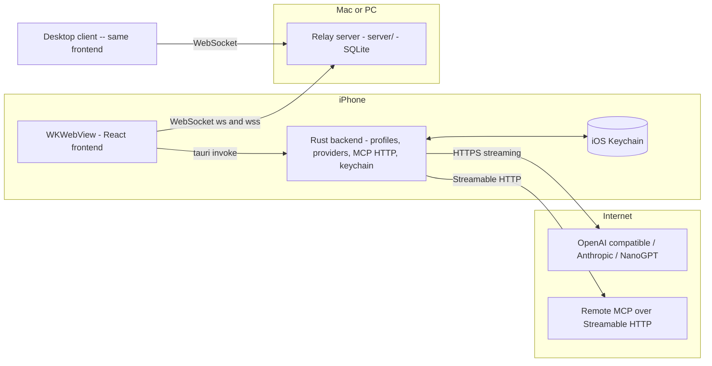

# Plan: Multichat on iOS

Add an iOS app alongside the existing desktop app, reusing the same React frontend and Rust
backend, keeping the core guarantee: **API keys never leave the device.**

## Current state (what we learned)

| Piece | Where | iOS readiness |
|---|---|---|
| React frontend | [`app/src/`](app/src/App.tsx) | Mostly ready: relay is a plain browser [`WebSocket`](app/src/lib/relay.ts:30) which WKWebView supports. Responsive drawer layout already exists ([`compactNav`](app/src/App.tsx:92)). |
| Rust backend | [`app/src-tauri/src/lib.rs`](app/src-tauri/src/lib.rs:1) | [`run()`](app/src-tauri/src/lib.rs:448) already has [`#[cfg_attr(mobile, tauri::mobile_entry_point)]`](app/src-tauri/src/lib.rs:447). All LLM calls, context building ([`context.rs`](app/src-tauri/src/context.rs:1)) and streaming ([`generate.rs`](app/src-tauri/src/generate.rs:1)) are portable Rust. |
| Keychain | [`app/src-tauri/src/secrets.rs`](app/src-tauri/src/secrets.rs:1) | [`keyring`](app/src-tauri/Cargo.toml:22) already enables `apple-native` — works with the iOS Keychain as-is. |
| Providers | [`app/src-tauri/src/providers/`](app/src-tauri/src/providers/mod.rs:1) | [`reqwest`](app/src-tauri/Cargo.toml:21) with rustls works on iOS. OpenAI-compatible and Anthropic providers are portable. |
| MCP | [`app/src-tauri/src/mcp.rs`](app/src-tauri/src/mcp.rs:1), [`rmcp`](app/src-tauri/Cargo.toml:27) | Needs work: `transport-child-process` cannot run on iOS (child processes forbidden). Streamable HTTP transport works on iOS. |
| Relay server | [`server/`](server/src/main.rs:1) | Unchanged — it is already platform-agnostic over WebSockets. |
| iOS project | [`app/src-tauri/tauri.conf.json`](app/src-tauri/tauri.conf.json:1) | Missing: `gen/apple` Xcode project, `Info.ios.plist`, signing setup. |

## Target scope

Full client parity on iOS, minus what the OS forbids:

- Rooms, membership, invite codes, presence, human messages — full parity.
- API profiles, iOS Keychain storage, Test connection, Fetch models — full parity.
- Streaming AI replies (deltas, reasoning, stop, interrupted, concurrent replies,
  regenerate with my profile) — full parity.
- MCP servers: **remote HTTP (Streamable HTTP) MCP works on iOS** (website-hosted MCP
  servers, e.g. `https://…/mcp`). Local-command (stdio) MCP is desktop-only because iOS
  forbids spawning processes — the iOS UI hides/disables it with an explanation. Tool
  images sharing works on iOS via the relay (already server-stored).
- Sanitized markdown rendering, code blocks, sandboxed HTML/SVG preview — full parity
  (all webview-side code).

Out of scope: Android, push notifications, background streaming when the app is
suspended (iOS suspends WebSockets in background; mitigations noted below), accounts.

## Architecture

Nothing changes architecturally — iOS is a second Tauri target of the same [`app/`](app/package.json:1):



The relay never sees keys or endpoints; on iOS the LLM calls still happen in Rust inside
the app ("bring your own AI" preserved).

## Key platform differences and decisions

1. **Builds require macOS.** Tauri iOS targets compile and sign only on macOS with Xcode.
   The plan keeps all code changes cross-platform and documents two build paths:
   a local Mac, or GitHub Actions macOS runners.
2. **Dev URL on device.** During `npm run tauri ios dev` on a physical iPhone, the app loads
   the Vite dev server over the LAN ([`devUrl`](app/src-tauri/tauri.conf.json:9)); on device
   builds the frontend is bundled ([`frontendDist`](app/src-tauri/tauri.conf.json:10)) as on
   desktop. No code change; document the flow.
3. **Cleartext `ws://` and ATS.** iOS App Transport Security blocks plain `ws://` to the
   public internet by default, but allows localhost and (with a usage string) the local
   network. Plan: add an `NSAppTransportSecurity` exception for local-network dev in
   [`Info.ios.plist`](app/src-tauri/tauri.conf.json:1), and recommend `wss://` tunnels
   (cloudflared/Tailscale — already documented in the README) for remote friends.
4. **Local network permission.** Reaching a LAN relay (e.g. `ws://192.168.x.x:8787/ws`)
   triggers the iOS local-network permission prompt; add `NSLocalNetworkUsageDescription`.
   The simulator has no such restriction.
5. **MCP on iOS.**
   - Gate the `rmcp` `transport-child-process` feature to desktop in
     [`app/src-tauri/Cargo.toml`](app/src-tauri/Cargo.toml:27); HTTP transport stays on all
     platforms.
   - In [`mcp.rs`](app/src-tauri/src/mcp.rs:1) and the settings UI, stdio servers are
     compiled out / hidden on iOS with a short note ("Local command servers run on desktop
     only; add a remote HTTP server instead").
   - HTTP MCP servers configured *on the phone* work the same as on desktop, including
     **Ask** approvals ([`resolve_tool_call`](app/src-tauri/src/lib.rs:357)) and tool chips.
6. **Instances / multi-window.** [`MULTICHAT_INSTANCE`](app/src-tauri/src/config.rs:8) and
   the window title logic ([`set_title`](app/src-tauri/src/lib.rs:462)) are desktop-only; on
   iOS use the single default instance and skip title handling behind `#[cfg(desktop)]`.
7. **Background behavior.** iOS suspends the WKWebView and its WebSocket when backgrounded.
   Current behavior degrades gracefully (relay marks in-flight AI replies interrupted only
   on disconnect — a suspended sender's stream pauses and resumes). Plan: rely on existing
   reconnect logic ([`Relay`](app/src/lib/relay.ts:12)) and document the limitation;
   optional follow-up: a keepalive/background-task treatment later.
8. **Mobile UX.** Safe-area insets (notch/home indicator) for the composer, keyboard-aware
   scrolling (the webview resizes when the keyboard opens), tap targets, and change the
   composer hint "Shift+Enter for newline" ([`RoomView.tsx`](app/src/components/RoomView.tsx:564))
   on touch devices. Existing responsive layout ([`useWidth`](app/src/lib/useWidth.ts:1),
   drawer sidebar, member list threshold) is the base.
9. **Relative swap/TS config.** Add mobile capability/permission entries so the frontend's
   [`invoke`](app/src/lib/backend.ts:3) calls work inside the iOS webview
   ([`capabilities/default.json`](app/src-tauri/capabilities/default.json:1) needs a mobile
   window label or shared permissions).

## Work breakdown

### 1. iOS project scaffolding and build tooling

- On a macOS machine (or CI): run `npm run tauri ios init` to generate
  `app/src-tauri/gen/apple`; commit the generated project (Xcode project + Rust build
  script) but keep signing settings out of git where possible.
- Add [`Info.ios.plist`](app/src-tauri/tauri.conf.json:1) with `NSLocalNetworkUsageDescription`
  and an ATS exception for local-network cleartext (dev usage).
- Set `bundle > ios` in [`tauri.conf.json`](app/src-tauri/tauri.conf.json:1) (minimum iOS 15,
  icon set via `tauri icon` with `--ios-color`).
- Add npm scripts: `npm run tauri ios dev` / `npm run tauri ios build` passthroughs and, if
  needed, an `ios` variant of [`scripts/instance.mjs`](app/scripts/instance.mjs:1) is NOT
  needed (no instances on iOS).
- Document both build paths in the README:
  - **Local Mac**: Xcode 15+, `rustup target add aarch64-apple-ios aarch64-apple-ios-sim`,
    `npm run tauri ios dev --open`, sign with a personal team in Xcode.
  - **GitHub Actions**: the detailed workflow is specified in
    [CI: GitHub Actions iOS build workflow](#ci-github-actions-ios-build-workflow) below —
    see that section for branches, jobs, secrets and artifacts in full.

### 2. Cross-platform backend compile gates

- [`app/src-tauri/Cargo.toml`](app/src-tauri/Cargo.toml:27): move `rmcp`
  `transport-child-process` to a desktop-only dependency section
  (`[target.'cfg(not(target_os = "ios"))'.dependencies]` or feature flags), keep
  `transport-streamable-http-client-reqwest` everywhere.
- [`mcp.rs`](app/src-tauri/src/mcp.rs:1): `#[cfg]`-gate stdio spawning code; return a clear
  error string if invoked on iOS.
- [`lib.rs`](app/src-tauri/src/lib.rs:459): guard `get_webview_window("main")`/`set_title`
  for desktop; iOS window config lives in `tauri.conf.json` (full-screen, no min sizes).
- [`config.rs`](app/src-tauri/src/config.rs:8): `MULTICHAT_INSTANCE` falls back to
  `default` on iOS (env vars do not exist there) — verify `instance_name()` behavior and
  hard-code the fallback explicitly.
- Confirm [`secrets.rs`](app/src-tauri/src/secrets.rs:1) writes to the iOS Keychain under
  service `multichat-bot` (keyring `apple-native`); add a unit smoke check if practical.

### 3. Capabilities and permissions

- Update [`app/src-tauri/capabilities/default.json`](app/src-tauri/capabilities/default.json:1)
  (or add `mobile.json`) so all [`invoke`](app/src/lib/backend.ts:3) commands and
  `tauri-plugin-opener` are allowed on the iOS window label (mobile windows use the
  `main`-annotated label; verify with the generated project).
- Review [`tauri.conf.json`](app/src-tauri/tauri.conf.json:23) CSP: `connect-src` already
  allows `ws:`/`wss:`/`ipc:`; confirm it is sufficient for the iOS webview and that the
  IPC origin (`http://ipc.localhost`) behaves the same on iOS.

### 4. Mobile UX pass (frontend)

- Safe-area: add `viewport-fit=cover` in [`app/index.html`](app/index.html:1) and
  `env(safe-area-inset-*)` padding to the composer and top bar.
- Keyboard: ensure the message list scrolls with the keyboard (webview resizes by default;
  verify composer stays visible in [`RoomView.tsx`](app/src/components/RoomView.tsx:1)).
- Touch affordances: replace hover-only affordances (tool chips, copy buttons), enlarge
  small tap targets, swap the "Shift+Enter for newline" hint for a mobile-appropriate one.
- Settings screens ([`Settings.tsx`](app/src/components/Settings.tsx:1)): hide **MCP
  servers** tab's stdio form on iOS (feature-detect via a `platform` value from
  [`get_state`](app/src-tauri/src/lib.rs:93) — add `platform` to [`ClientState`](app/src-tauri/src/lib.rs:81)),
  show a one-line explanation instead.
- Dark mode / Tailwind already theme-driven ([`theme.ts`](app/src/theme.ts:1)); verify
  contrast on OLED and system dark/light switching sanity.

### 5. MCP parity where feasible

- Remote **Streamable HTTP** MCP: verify [`test_mcp_server`](app/src-tauri/src/lib.rs:331)
  and tool execution paths work on iOS with HTTPS endpoints (add `NSAppTransportSecurity`
  allowance only if a specific HTTP-only server is needed; default is HTTPS-required).
- Tool approval flow ([`Approvals`](app/src-tauri/src/lib.rs:33)) works on the same task
  runtime — confirm the `Ask` prompt renders acceptably as a mobile sheet.
- Tool image sharing (already relay-stored; [`images.ts`](app/src/lib/images.ts:1))
  unaffected on iOS.

### 6. Testing and verification

- **Simulator**: run the relay on the Mac/PC (`MULTICHAT_ADDR=0.0.0.0:8787`), install the
  app in the iOS Simulator, join a room, exchange messages with a desktop client, trigger
  AI replies (use [`tools/mock-llm.mjs`](tools/mock-llm.mjs:1) pointed at the host's LAN IP
  from the simulator).
- **Real device**: dev-sign and install on the user's iPhone over USB (`tauri ios dev`
  with a personal team); verify local-network permission prompt appears once and the app
  reaches `ws://192.168.x.x:8787/ws`; verify keychain persistence across app restarts.
- **Streaming**: confirm delta batching, **Stop**, concurrent replies, and the
  *interrupted* marking when the phone backgrounds mid-stream.
- **HTTP MCP**: add a website MCP server (e.g. a hosted Streamable HTTP endpoint), run
  `Test & list tools`, use **Ask** mode with a tool call in a room.
- **Regression**: keep desktop flows working — `cargo test` in [`app/src-tauri`](app/src-tauri/Cargo.toml:1)
  (context building, trimming), [`tools/smoke-test.mjs`](tools/smoke-test.mjs:1) against
  the relay, plus a manual desktop checklist (profiles, stdio MCP, images).
- CI: exercise the workflow described in
  [CI: GitHub Actions iOS build workflow](#ci-github-actions-ios-build-workflow) on both
  unsigned simulator builds and (available secrets permitting) signed device builds.

### 7. Documentation

- Extend [`README.md`](README.md:1): new "iOS" section covering prerequisites (macOS +
  Xcode + Rust iOS targets), simulator run, physical-device run with a personal team,
  TestFlight/distribution pointer (free vs paid Apple Developer account), ATS/local
  network notes, and the MCP limitation table (stdio desktop-only).
- Note in the README security section: on iOS the keys live in the iOS Keychain and the
  same "keys never leave the device" guarantee holds.

## CI: GitHub Actions iOS build workflow

A single workflow file [`.github/workflows/ios.yml`](.github/workflows/ios.yml) builds the
iOS app on a macOS runner so the Windows machine never needs Xcode. Two jobs cover the two
needs: a **simulator** build (no Apple account required — good first target) and a
**device/release** build (needs a paid Apple Developer account and signing secrets).

### Triggers and runner

- Triggers: `workflow_dispatch` (manual, with an optional `simulator` boolean input),
  pushes to tags `v*`, and pull requests touching `app/**`, `server/**` excluded
  (the relay is not part of the mobile artifact).
- Runner: `macos-latest` (Apple Silicon). Both jobs share one concurrency group
  `ios-${{ github.ref }}` with `cancel-in-progress: true`.
- Toolchain setup in every job:
  1. `actions/checkout@v4`
  2. `dtolnay/rust-toolchain@stable` (no pinned version — same as the start scripts)
  3. `rustup target add aarch64-apple-ios aarch64-apple-ios-sim x86_64-apple-ios` — the last
     one only if an Intel-simulator artifact is wanted; default to the two `aarch64` targets.
  4. `actions/setup-node@v4` with `node-version: 22` (matches the README's Node 22+ rule)
     and `cache: npm` against [`app/package-lock.json`](app/package-lock.json:1).
  5. `npm ci` in `app/` (never `npm install` in CI).
  6. `cargo cache` via `Swatinem/rust-cache@v2` with `workspaces: app/src-tauri -> target`
     keyed on `Cargo.lock` so dependency builds stay fast across runs.

### Job 1: `build-simulator` (unsigned, always runs)

```yaml
# shape of the job, kept in the plan so implementation is mechanical
build-simulator:
  runs-on: macos-latest
  steps:
    - checkout, rust toolchain + aarch64-apple-ios-sim target, node 22, npm ci
    - run: npm run tauri -- ios build --target aarch64-apple-ios-sim
      working-directory: app
    - upload-artifact: app/src-tauri/gen/apple/build/**/*.app -> multichat-ios-sim
```

- No code signing: the simulator tolerates unsigned builds, so this job works with **no
  secrets at all** and proves the Rust cross-compile ([`lib.rs`](app/src-tauri/src/lib.rs:1),
  [`providers/`](app/src-tauri/src/providers/mod.rs:1), [`mcp.rs`](app/src-tauri/src/mcp.rs:1)
  with the iOS feature gates) plus the frontend bundle all build for iOS.
- Artifact: `multichat-ios-sim-<sha>` containing the `.app`. Installing it is a local
  `xcrun simctl install booted <app>` — README documents this.
- If the incoming Node/Rust toolchain versions change, the job fails loudly, which is the
  point: the Windows machine cannot catch iOS compile errors locally.

### Job 2: `build-device` (signed, runs only when secrets exist)

```yaml
build-device:
  runs-on: macos-latest
  needs: build-simulator
  if: github.event_name == 'workflow_dispatch' || startsWith(github.ref, 'refs/tags/v')
  steps:
    - checkout, rust toolchain + aarch64-apple-ios target, node 22, npm ci
    - import signing material (decode base64 secrets; see below)
    - run: npm run tauri -- ios build --target aarch64-apple-ios
      working-directory: app
      env:
        IOS_CERTIFICATE: ${{ secrets.IOS_CERTIFICATE }}
        IOS_CERTIFICATE_PASSWORD: ${{ secrets.IOS_CERTIFICATE_PASSWORD }}
        IOS_MOBILE_PROVISION: ${{ secrets.IOS_MOBILE_PROVISION }}
    - upload-artifact: the .ipa produced under app/src-tauri/gen/apple/ -> multichat-ios-device
```

- The Tauri CLI reads `IOS_CERTIFICATE`, `IOS_CERTIFICATE_PASSWORD` and
  `IOS_MOBILE_PROVISION` natively during `ios build` — no custom signing code is needed.
- Secrets (base64-encoded so they survive GitHub's text-only secret values):
  - `IOS_CERTIFICATE` — the `.p12` of the Apple Distribution or Development certificate,
    base64 (`base64 -i cert.p12 | pbcopy` on a Mac).
  - `IOS_CERTIFICATE_PASSWORD` — the p12 password, plain text.
  - `IOS_MOBILE_PROVISION` — the `.mobileprovision` profile, base64.
  - `IOS_CERTIFICATE_NAME` (optional) — signing identity name if several are present.
- Guard the job with `if: … && secrets.IOS_CERTIFICATE != ''` style conditionality where
  possible, or let it fail-skipped on forks, so PRs from contributors without secrets stay
  green via job 1 alone.
- Artifact: `multichat-ios-device-<sha>` containing the `.ipa`. Side-loading is
  `xcrun devicectl device install app` or Xcode → Devices, and distribution via TestFlight
  is `altool`/`Transporter` upload of the same `.ipa` (documented but optional).

### What is deliberately kept out of CI for v1

- No automatic TestFlight upload (`apple-actions/import-codesign-certs` + `altool` can be
  added later once the paid account exists).
- No Android job — out of scope.
- No e2e against the relay (the simulator job is a compile gate; protocol behavior is
  covered by [`tools/smoke-test.mjs`](tools/smoke-test.mjs:1) on the existing runner-less
  local flow). A follow-up could add a third job running the relay plus
  `smoke-test.mjs` on `macos-latest` since it needs no signing.

### Local fallback if CI secrets are not available yet

The workflow still delivers value immediately: fork/PR runs produce the simulator `.app`,
and the README maps this to the device-testing story (simulator first, personal-team dev
signing from Xcode when a physical iPhone test is needed).

## Milestones (matching the repo's existing milestone style)

1. iOS project scaffolding; app boots in the iOS Simulator and connects to the relay
   with human-only chat between phone and desktop.
2. Profiles + keychain + test connection on iOS.
3. Streaming AI replies from the phone using the sender's profile.
4. MCP HTTP on iOS + mobile UX polish (safe areas, keyboard, touch targets).
5. Real-device signing, docs, optional CI build workflow.

Each milestone ends with a two-client check (iPhone + desktop) before moving on.

## Open questions / assumptions

- Distribution: plan assumes simulator + personal-device dev signing first (works with a
  free Apple account, 7-day resign cycle); TestFlight/App Store steps are documented but
  optional (needs paid account).
- If the repo must stay buildable on Windows without `gen/apple`, keep the generated
  Xcode project committed and CI as the macOS build path.